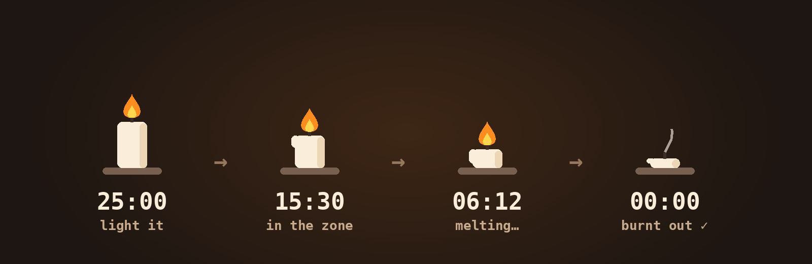

<p align="center">
  
</p>

<h1 align="center">Wick 🕯️</h1>

<p align="center">
  <b>Light a candle. Focus till it melts.</b><br>
  <sub>A tiny, silent Pomodoro timer that lives in your Mac's menu bar and slowly melts while you work.</sub>
</p>

<p align="center">
  <a href="../../releases/latest"></a>
  
  
  
</p>

<p align="center">
  
</p>

---

## 🔥 The pitch

Your brain is a browser with 47 tabs open. Wick closes 46 of them.

It's built on the **Pomodoro Technique**: work for **25 minutes with zero distractions**, then take a **5-minute break**. Repeat until the to-do list fears you.

But instead of a boring ticking number, you get a **candle**. Click it, it lights up. As your focus burns, the wax melts and drips. In the final minute the flame starts to flicker nervously. When it's gone… you've earned a stretch and a glass of water.

## ✨ What it does

| | |
|---|---|
| 🕯️ **Melting candle** | Lives in your menu bar, shrinks and drips as time passes. Flickers in the last 60 seconds for drama. |
| 👆 **One click to light** | Click the candle, 25 minutes start. That's the whole onboarding. |
| 🖱️ **Right-click for the rest** | Pause, skip to break, blow it out (reset), settings. |
| ⏱️ **Live countdown** | Shown right next to the candle. Too stressful? Hide it and just watch the wax. |
| 🤫 **Strictly no sound** | No dings, no gongs, no singing bowls. Ever. |
| 📳 **Silent nudges** | When time's up: a haptic *thump* on your trackpad, a wiggling candle in the menu bar, and a soundless notification. |
| ☕ **Breaks start themselves** | 5 minutes, plus a gentle "stand up and drink water". Your spine says thanks. |
| 🔥 **Streak counter** | *"Burnt 5 candles today 🕯️"*, plus your all-time total. Resets at midnight, like Cinderella. |
| 🪶 **Featherweight** | Native Swift + AppKit, zero dependencies, no Dock icon, no account, no tracking. |

## 📦 Get it

### The 30-second way

1. Grab **[Wick.zip from the latest release](../../releases/latest)** and unzip it.
2. Drag **Wick.app** into **Applications**.
3. First launch only: **right-click Wick.app → Open → Open**.
   <sub>Wick isn't notarized by Apple (that costs $99/year and this candle is free), so macOS double-checks once.</sub>
4. Allow notifications, then find the little candle up in your menu bar.

Still blocked? One Terminal line sorts it:

```bash
xattr -dr com.apple.quarantine /Applications/Wick.app
```

### The "I compile my own candles" way

All you need is the Xcode Command Line Tools (`xcode-select --install`). No full Xcode required.

```bash
git clone https://github.com/vipulpopli7534/wick.git
cd wick
./build.sh --install    # builds, drops it in /Applications, lights it up
```

`./build.sh` just builds into `build/Wick.app`, and `./build.sh --zip` also makes a shareable `build/Wick.zip`.

## 🎮 How to use it

| You do | Wick does |
|---|---|
| **Click** the candle | 🔥 Lights it. 25 minutes of focus begins. |
| **Click** while paused | ▶️ Picks up where you left off |
| **Right-click** (or click while burning) | 📋 Menu: pause · skip · blow it out · streak · settings |
| See the candle **wiggling**? Click it | 🙋 "Yes, I saw it." The wiggle stops. |

### Speed-run mode

Want to see the whole show without waiting 25 minutes? Launch it with 25-*second* sessions and 5-*second* breaks:

```bash
WICK_FAST=1 /Applications/Wick.app/Contents/MacOS/Wick
```

## 🤔 FAQ

**Why a candle?**
A number counting down feels like a deadline. A candle melting feels like something you're *spending* well. Also it's cute. Mostly it's cute.

**"Vibration" on a MacBook? Really?**
MacBooks don't have a vibration motor. Wick uses the Force Touch trackpad's haptic engine instead, which macOS only delivers while a finger is resting on the trackpad. That's why it also wiggles the candle and sends a silent banner, so you never miss the moment.

**Why no sound?**
Because you might be in a library, a meeting, or a very quiet mood. Silence is a feature.

**Does it track me?**
No. It doesn't even know what the internet is. Your streak lives in your Mac's local preferences.

**What does "Open at login" need?**
macOS 13 or newer. On older Macs, add Wick under System Settings → General → Login Items.

## 🧱 What's inside

```
Sources/
├── WickApp.swift         🚪 entry point (menu bar only, no Dock icon)
├── AppDelegate.swift     🎛️  clicks, menu, nudges
├── FocusTimer.swift      ⏱️  focus → break state machine
├── CandleRenderer.swift  🕯️  draws the melting candle
├── Nudger.swift          📳 haptics + silent notifications
├── HeaderView.swift      🖼️  the big candle at the top of the menu
└── Streak.swift          🔥 candles burnt today / all-time
Resources/                Info.plist + app icon
build.sh                  builds Wick.app with plain swiftc
```

## 🚀 Shipping a new version

Every push to `main` gets built by GitHub Actions. To publish a downloadable release:

```bash
git tag v1.1.0 && git push origin v1.1.0
```

A universal (Apple Silicon + Intel) `Wick.zip` appears under Releases a couple of minutes later. ✨

## 🤝 Contributing

Ideas welcome! Some candles waiting to be lit:

- [ ] Custom focus and break lengths
- [ ] A long break after every 4 candles
- [ ] Scented candles (themes: lavender, vanilla, burnt toast)
- [ ] Weekly melt-stats

Open an issue or a PR. Be kind, keep it silent.

## 📜 License

[MIT](LICENSE). Fork it, remix it, light your own candle.

<p align="center"><sub>Made with 🔥 and a lot of melted wax.</sub></p>
