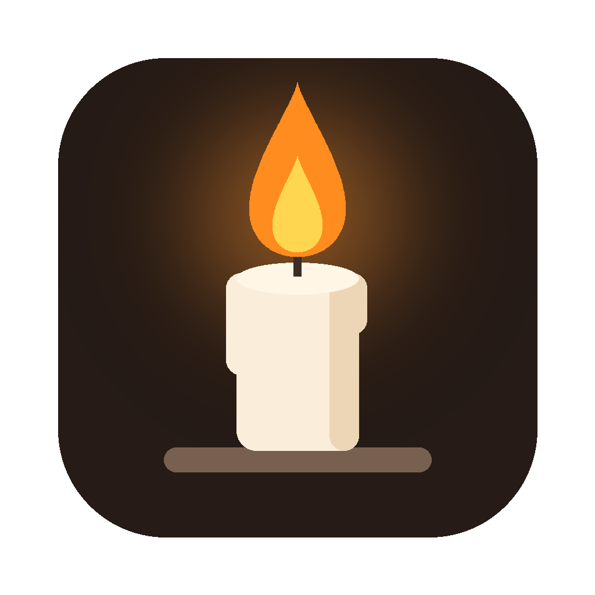

<p align="center">
  
</p>

<h1 align="center">Wick</h1>
<p align="center"><b>Light a candle. Focus till it melts.</b><br>
A tiny, silent Pomodoro timer that lives in your Mac's menu bar.</p>

---

Wick is built around the Pomodoro idea: **25 minutes of focused, undisturbed work, then a 5-minute break.**
Click the candle in your menu bar to light it. It slowly melts as your focus session burns down, flickers in the final minute, and nudges you, silently, when it's time to stand up.

## Features

- 🕯️ **A melting candle** in the menu bar that shrinks and drips as time passes, with a flickering flame in the last minute
- ⏱️ **Live countdown** next to the candle, or hide it and keep just the icon
- 👆 **One click to start.** Right-click to pause, skip, or reset
- 🤫 **No sound, ever.** When time's up you get:
  - a haptic *thump* on the Force Touch trackpad (when your finger is on it)
  - a wiggling candle in the menu bar until you click it
  - a silent notification banner
- ☕ **Breaks start automatically** with a nudge to stand up and drink water
- 🔥 **Streak counter:** "Burnt 5 candles today 🕯️", plus your all-time total
- 🚀 **Open at login**, no Dock icon, tiny and native (Swift + AppKit, no dependencies)

## Install

### Download (easiest)

1. Download **Wick.zip** from the [latest release](../../releases/latest) and unzip it.
2. Drag **Wick.app** into your **Applications** folder.
3. The first time, **right-click Wick.app → Open → Open**. (Wick isn't notarized by Apple, so macOS asks once.)
   If macOS still blocks it, run this once in Terminal:
   ```bash
   xattr -dr com.apple.quarantine /Applications/Wick.app
   ```
4. Allow notifications when asked, and look for the candle in your menu bar.

### Build from source

You only need the Xcode Command Line Tools (`xcode-select --install`). Full Xcode isn't required.

```bash
git clone https://github.com/<your-username>/wick.git
cd wick
./build.sh --install   # builds, copies to /Applications and launches
```

Other options: `./build.sh` (just build into `build/Wick.app`) and `./build.sh --zip` (also create `build/Wick.zip`).

Requires macOS 13 Ventura or later. Runs natively on Apple Silicon and Intel.

## How to use

| Action | What happens |
| --- | --- |
| **Click** the candle | Light it: a 25-minute focus session starts |
| **Click** while paused | Resume |
| **Right-click** (or click while running) | Menu: pause, skip, reset, streak, settings |
| Candle wiggling? **Click it** | Stops the nudge |

**Tip:** to try the whole flow quickly, launch it in test mode with 25-*second* focus and 5-*second* breaks:

```bash
WICK_FAST=1 /Applications/Wick.app/Contents/MacOS/Wick
```

## Why no vibration motor?

MacBooks don't have one. The closest thing is the Force Touch trackpad's haptic engine, which Wick taps in short bursts while the candle wiggles. macOS only delivers it while a finger is resting on the trackpad, so the wiggle and the silent banner make sure you never miss the end of a session.

## Releasing a new version (for maintainers)

Every push to `main` is built by GitHub Actions. To publish a downloadable release:

```bash
git tag v1.0.0
git push origin v1.0.0
```

The workflow builds a universal `Wick.zip` and attaches it to a new GitHub release automatically.

## Project layout

```
Sources/
  WickApp.swift         app entry point (menu bar only, no Dock icon)
  AppDelegate.swift     menu bar item, clicks, menu, nudges
  FocusTimer.swift      focus / break state machine
  CandleRenderer.swift  draws the melting candle
  Nudger.swift          haptics + silent notifications
  HeaderView.swift      big candle at the top of the menu
  Streak.swift          candles burnt today / all-time
Resources/              Info.plist and app icon
build.sh                builds Wick.app with swiftc
```

## License

[MIT](LICENSE). Fork it, remix it, light your own candle.
